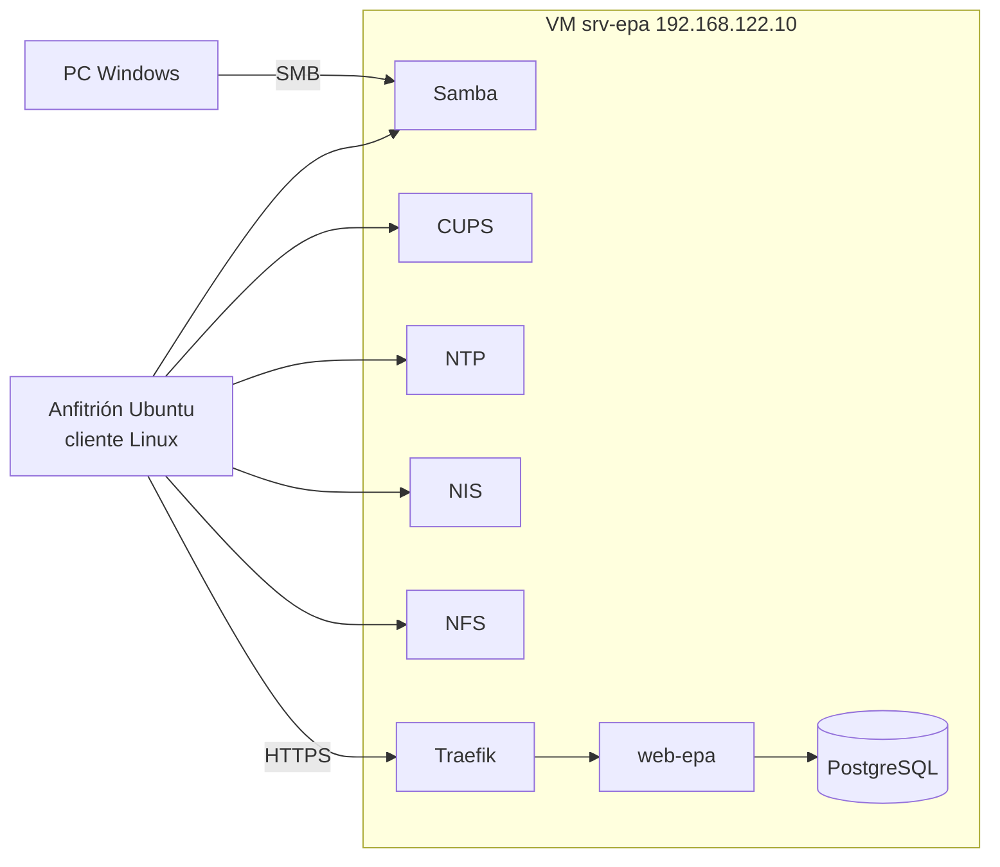

# Análisis y diseño: Empresas Públicas de Armenia (EPA E.S.P.)

## 1. La empresa

**Empresas Públicas de Armenia E.S.P.** es una Empresa Industrial y Comercial del Estado, del orden municipal, constituida el 15 de diciembre de 1962. Presta los servicios públicos domiciliarios de **acueducto, alcantarillado y aseo** en Armenia (Quindío) y atiende a más de 120.000 suscriptores por servicio. Tiene áreas administrativas (gerencia, comercial, jurídica), técnicas y operativas, y un proceso intenso de **atención al ciudadano** (peticiones, quejas, reclamos y reportes de daños).

## 2. Necesidades y servicios propuestos

| Necesidad de la EPA | Servicio | Justificación |
|---|---|---|
| Presencia institucional y canal para radicar PQR y reportes de daños | **Web (Dokploy + Traefik)** | Sitio institucional con formulario de PQR, desplegado como contenedor desde Git, con HTTPS y redespliegue automático |
| Guardar las PQR y los datos de atención | **Base de datos PostgreSQL (Dokploy)** | Base relacional administrada desde el mismo panel, accesible solo dentro de la red interna de contenedores |
| Facturación, turnos de cuadrillas y registros con hora exacta | **NTP (chrony)** | Todos los equipos con la misma hora: logs, facturas y trazabilidad confiables, incluso sin internet (`local stratum 10`) |
| Compartir informes técnicos entre equipos Linux del área técnica | **NFS** | Montaje nativo en Linux, permisos por UID y `root_squash` |
| Usuarios únicos para todas las estaciones | **NIS** | Se crea el usuario una vez en el servidor y entra en cualquier cliente |
| Imprimir facturas, actas y reportes desde cualquier equipo | **CUPS** | Cola central de impresión compartida por IPP (se usa impresora virtual PDF) |
| Carpetas compartidas para los equipos Windows de las oficinas | **Samba** | Acceso desde el Explorador de Windows con usuario/contraseña y carpetas por área (gerencia privada) |

## 3. Tabla de requisitos

| Servicio | Host / IP | Puerto | Protocolo | Tipo |
|---|---|---|---|---|
| SSH (administración) | srv-epa 192.168.122.10 | 22 | TCP | Acceso remoto |
| Traefik (web HTTP→HTTPS) | 192.168.122.10 | 80 / 443 | TCP (HTTP/2, TLS) | Proxy inverso (Dokploy) |
| Panel Dokploy | 192.168.122.10 | 3000 | TCP | PaaS |
| Sitio web `web-epa` | contenedor (red `dokploy-network`) | 3000 interno | HTTP | Aplicación Node.js |
| PostgreSQL `bd-epa` | contenedor (red interna) | 5432 interno | TCP | Base de datos (no expuesta) |
| NTP | 192.168.122.10 | 123 | UDP | Sincronización horaria |
| NFS | 192.168.122.10 | 2049 (+111 rpcbind) | TCP | Archivos Linux |
| NIS | 192.168.122.10 | 111 + ypserv (dinámico) | UDP/TCP (RPC) | Autenticación |
| CUPS | 192.168.122.10 | 631 | TCP (IPP/HTTPS) | Impresión |
| Samba | 192.168.122.10 | 139 / 445 | TCP (SMB2/3) | Archivos Windows |

Dominio interno: `epa.lan` (`www.epa.lan`, `dokploy.epa.lan`, `srv-epa.epa.lan`), con certificado autofirmado `*.epa.lan`. Dominio NIS: `epanis`.

## 4. Arquitectura

El diagrama completo está en [`diagrama.mmd`](diagrama.mmd).

## 5. Decisiones de diseño

- **Un solo servidor (VM `srv-epa`)** con Dokploy para las aplicaciones (web y BD en contenedores) y los servicios Linux tradicionales instalados directamente en el sistema.
- **KVM en lugar de VirtualBox:** el anfitrión tiene Secure Boot y un Windows en el disco interno. KVM viene en el kernel con módulos firmados, así que no hubo que tocar la BIOS (ver [docs/infraestructura-base.md](docs/infraestructura-base.md)).
- **IP fija** por netplan más reserva DHCP en libvirt.
- **chrony en lugar de ntp:** el paquete `ntp` ya no existe en Ubuntu 24.04 (decisión de la Integrante 4).
- **Certificado autofirmado:** el entorno es local (lo autorizó el profesor). Let's Encrypt requiere un dominio público con los puertos 80/443 accesibles desde internet.
- **Seguridad básica:** `root_squash` en NFS, `securenets` en NIS, `guest ok = no` en Samba, la BD sin exponer y SSH con llave.

## 6. Costo-beneficio (resumen)

| Opción | Costo aproximado | Comentario |
|---|---|---|
| Esta solución (software libre en servidor propio) | Solo el hardware (servidor existente) y el tiempo de administración | Linux, Dokploy, Samba, NFS, NIS, CUPS y chrony sin licencias |
| Equivalente con licencias (Windows Server + CALs, IIS, SQL Server) | Licencias por servidor y por usuario | Mayor costo recurrente para el mismo alcance |
| Nube administrada (PaaS + BD + archivos) | Pago mensual por uso | Menos administración, pero costo continuo y dependencia de internet para servicios internos |

Beneficio principal: se centralizan la web, la base de datos, los archivos, la impresión, la hora y los usuarios en un servidor local administrable, y el despliegue de aplicaciones se automatiza desde Git con Dokploy.
