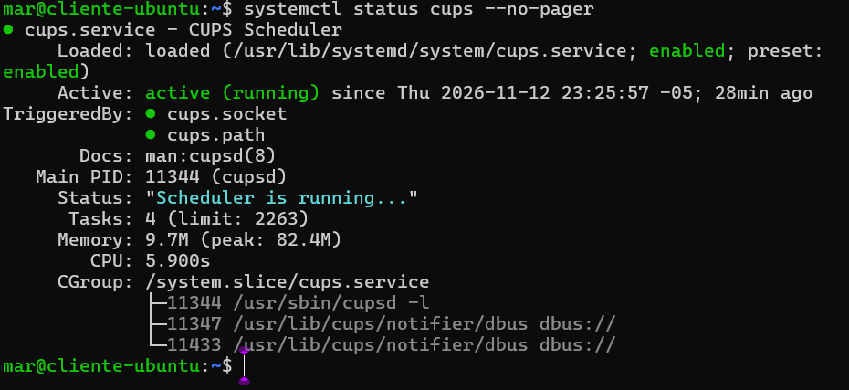
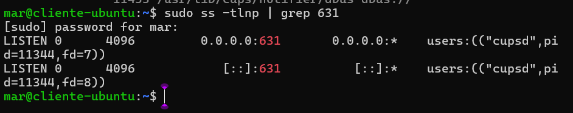
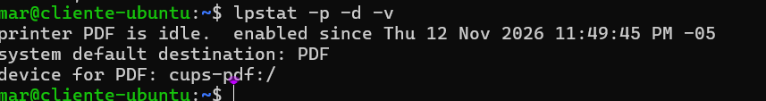
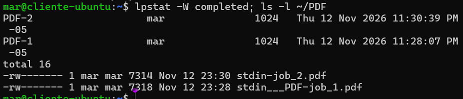
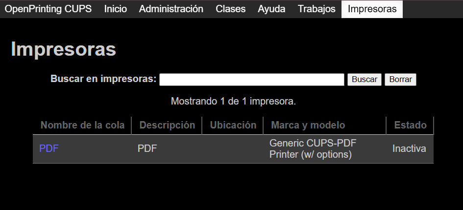
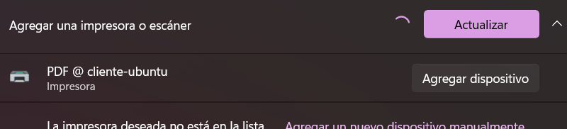
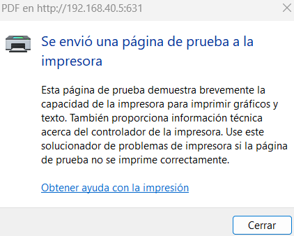
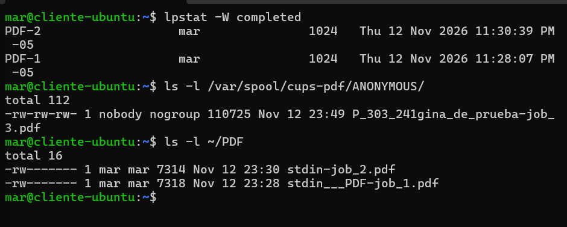

# Servicio de impresión (CUPS)

**Responsable:** Integrante 4
**Servidor:** Ubuntu Server 24.04.5 LTS en VirtualBox (red en modo Bridged)
**IP del servidor:** 192.168.40.5/24 | **Puerto:** 631/TCP (IPP)
**Cliente de pruebas:** Windows 11 (equipo anfitrión)

## 1. Objetivo

Configurar un servidor de impresión que comparta una impresora en la red local y mantenga una cola operativa, de modo que los clientes puedan enviar trabajos de impresión.

## 2. Decisión de diseño: impresora virtual PDF

No se dispone de una impresora física, por lo que se usó **cups-pdf**, una impresora virtual que convierte cada trabajo en un archivo PDF en el servidor. Funciona igual que una impresora real desde el punto de vista de CUPS: tiene cola, estado, trabajos completados y se comparte por IPP.

## 3. Instalación

```bash
sudo apt update
sudo apt install cups cups-pdf -y
sudo systemctl enable --now cups
sudo usermod -aG lpadmin mar
```

El usuario `mar` se agregó al grupo `lpadmin` para poder administrar la impresora.

## 4. Configuración

### 4.1 Compartir e iniciar el acceso remoto

```bash
sudo cupsctl --share-printers --remote-admin --remote-any
sudo systemctl restart cups
```

| Opción | Función |
|---|---|
| `--share-printers` | Comparte en la red las impresoras marcadas como compartidas |
| `--remote-admin` | Permite administrar CUPS desde otros equipos |
| `--remote-any` | Acepta conexiones desde cualquier dirección de la red |

Con esto `cupsd` pasa a escuchar en `0.0.0.0:631` en lugar de solo en localhost.

### 4.2 Marcar la impresora como compartida

La impresora `PDF` (dispositivo `cups-pdf:/`) fue creada por el paquete `cups-pdf`.

```bash
sudo lpadmin -p PDF -o printer-is-shared=true
lpstat -l -p PDF | grep -i shared
```

El archivo de configuración final está en [`configs/cups/cupsd.conf`](../configs/cups/cupsd.conf).

### 4.3 Ubicación de los PDF generados

La directiva `Out` de `/etc/cups/cups-pdf.conf` define dónde se guardan:

```bash
grep -E "^Out|^AnonDirName|^AnonUser" /etc/cups/cups-pdf.conf
```

| Quién imprime | Dónde queda el PDF |
|---|---|
| Usuario local (`mar`) | `/home/mar/PDF/` (`Out ${HOME}/PDF`) |
| Cliente remoto (Windows) | `/var/spool/cups-pdf/ANONYMOUS/` |

## 5. Verificación en el servidor

### 5.1 Servicio activo

```bash
systemctl status cups --no-pager
```



### 5.2 Puerto 631 en escucha

```bash
sudo ss -tlnp | grep 631
```



### 5.3 Impresora, destino por defecto y dispositivo

```bash
lpstat -p -d -v
```

La impresora `PDF` aparece habilitada (`idle`), como destino por defecto y con dispositivo `cups-pdf:/`.



### 5.4 Prueba local

```bash
echo "Prueba CUPS servidor" | lp -d PDF
lpstat -W completed
ls -l ~/PDF
```

Los trabajos `PDF-1` y `PDF-2` quedaron como completados, la cola de pendientes (`lpstat -o`) está vacía y los PDF aparecen en `~/PDF`.



### 5.5 Impresora compartida

```bash
lpstat -l -p PDF | grep -i shared
```


### 5.6 Interfaz web de CUPS

Se accede desde `https://192.168.40.5:631/printers/`. El navegador muestra la advertencia de certificado autofirmado (ver sección 8); se acepta la excepción con **Advanced → Proceed**.



## 6. Cliente Windows

### 6.1 Detección de la impresora

Windows detectó la impresora compartida por la red como **PDF @ cliente-ubuntu**.


### 6.2 Agregar la impresora

Configuración → Bluetooth y dispositivos → Impresoras y escáneres → Agregar dispositivo → *Seleccionar una impresora compartida por nombre*:

```
http://192.168.40.5:631/printers/PDF
```

Como controlador se eligió el genérico de **Microsoft** (IPP Class Driver). Windows confirmó: *"Agregaste PDF en http://192.168.40.5:631 correctamente"*.



### 6.3 Página de prueba

Se imprimió una página de prueba desde Windows.



### 6.4 El servidor recibió el trabajo

En el servidor:

```bash
lpstat -W completed
ls -l /var/spool/cups-pdf/ANONYMOUS/
```

El trabajo de Windows (job 3) quedó completado y generó el archivo `P_303_241gina_de_prueba-job_3.pdf` (el nombre contiene la codificación de la "á" de "Página") en la carpeta `ANONYMOUS`.



## 7. Resultado

| Criterio | Estado |
|---|---|
| Servicio CUPS activo | Cumplido |
| Impresora compartida en la red | Cumplido (`PDF`, puerto 631) |
| Cola operativa | Cumplido (trabajos completados, cola vacía) |
| Impresión desde cliente | Cumplido (Windows, job 3) |

## 8. Problemas encontrados y solución

| Problema | Causa | Solución |
|---|---|---|
| Los PDF no aparecían en `/var/spool/cups-pdf/` tras imprimir | `cups-pdf` guarda los trabajos de usuarios locales en `${HOME}/PDF`, y solo los remotos van a `ANONYMOUS` | Revisar `/etc/cups/cups-pdf.conf` y buscar en `~/PDF` y en `ANONYMOUS` |
| El navegador muestra "Your connection is not private" al abrir `https://192.168.40.5:631` | CUPS usa un certificado autofirmado | Aceptar la excepción (Advanced → Proceed). En producción se usaría un certificado de Let's Encrypt o de una CA interna |
| Windows pide un controlador y muestra una lista de fabricantes (Aisino, AlphaCard…) | Es la lista genérica de controladores de impresoras físicas | Elegir **Microsoft** y su controlador de clase genérico; no usar "Usar disco" |
| Aviso "La detección de redes y el uso compartido de archivos están desactivados" en el Explorador | Es una opción de Windows para ver equipos en la carpeta Red | No afecta a CUPS, que funciona por IPP con la URL directa |
| Sin impresora física | El entorno de laboratorio no la incluye | Se usó la impresora virtual `cups-pdf` |
