# Infraestructura base: VM, Dokploy, dominio y HTTPS

**Responsable:** Integrante 1 (coordinación e integración)
**Anfitrión:** Ubuntu 26.04 LTS en disco externo (HP Victus, AMD Ryzen, 12 hilos, 14 GB RAM)
**Servidor:** VM `srv-epa`: Ubuntu Server 24.04.5 LTS, 2 vCPU, 4 GB RAM, disco de 40 GB, IP fija `192.168.122.10`

## 1. Hipervisor: por qué KVM y no VirtualBox

El primer intento fue con VirtualBox 7.2 (ver la sección 6, *Problemas encontrados*). El anfitrión tiene **Secure Boot activo** y un Windows en el disco interno que no se debía modificar. VirtualBox necesita módulos del kernel firmados con una llave MOK propia, y en este equipo el gestor de llaves MOK nunca apareció al arrancar. Por eso no se pudo registrar la llave.

Se usó **KVM/QEMU con libvirt**, el hipervisor integrado en el kernel de Linux. Sus módulos vienen firmados por Ubuntu y funcionan con Secure Boot sin cambiar nada en la BIOS. Cumple los mismos requisitos: VM Ubuntu Server con 2 vCPU, 4 GB, 40 GB e IP fija.

**Red:** el anfitrión se conecta por Wi-Fi y KVM no puede hacer *bridge* sobre Wi-Fi. La VM usa la red NAT de libvirt (`virbr0`, 192.168.122.0/24) con **IP estática** y además una **reserva DHCP**. Los clientes de la LAN (PC Windows) llegan a Samba mediante un reenvío de puerto en el anfitrión (ver [samba.md](samba.md)).

## 2. Instalación de KVM/libvirt

```bash
sudo apt install -y qemu-system-x86 libvirt-daemon-system virtinst virt-manager
sudo systemctl enable --now libvirtd
sudo virsh net-autostart default; sudo virsh net-list --all
```
Instala el hipervisor y deja activa la red virtual `default`.

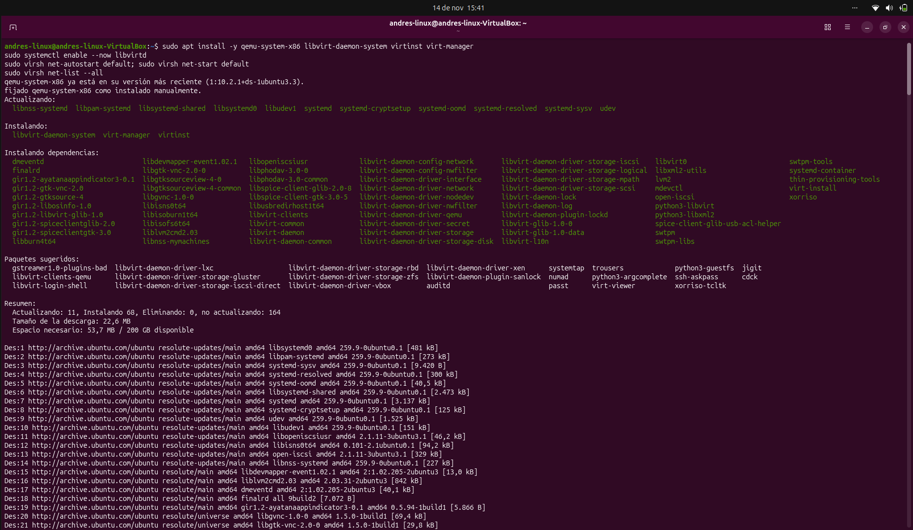

## 3. Creación de la VM

Se usa la imagen oficial **Ubuntu Server 24.04 cloud image** junto con **cloud-init**. Así la VM sale configurada (usuario, nombre, zona horaria, llave SSH e IP fija) sin pasar por el instalador manual.

```bash
# Disco de 40 GB a partir de la imagen oficial
sudo qemu-img convert -O qcow2 noble.img /var/lib/libvirt/images/srv-epa.qcow2
sudo qemu-img resize /var/lib/libvirt/images/srv-epa.qcow2 40G

# Reserva DHCP + configuración inicial (usuario, red estática) en un ISO "seed"
sudo virsh net-update default add ip-dhcp-host "<host mac='52:54:00:ea:00:01' name='srv-epa' ip='192.168.122.10'/>" --live --config
sudo cloud-localds --network-config=network-config /var/lib/libvirt/images/srv-epa-seed.iso user-data meta-data

# VM: 2 vCPU, 4 GB RAM, disco virtio, red NAT con MAC fija
sudo virt-install --name srv-epa --memory 4096 --vcpus 2 \
  --disk path=/var/lib/libvirt/images/srv-epa.qcow2,format=qcow2,bus=virtio \
  --disk path=/var/lib/libvirt/images/srv-epa-seed.iso,device=cdrom \
  --network network=default,model=virtio,mac=52:54:00:ea:00:01 \
  --osinfo ubuntu24.04 --import --graphics none --noautoconsole
sudo virsh autostart srv-epa
```
Los archivos `user-data` y `network-config` están en [`configs/vm/`](../configs/vm/).

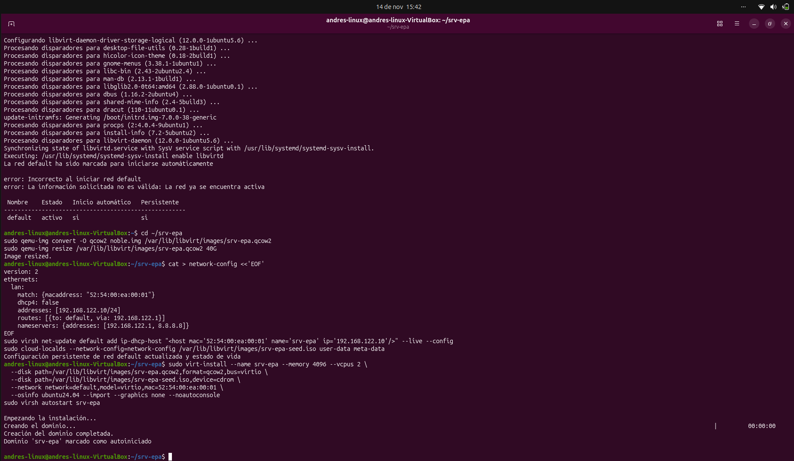

```bash
sudo virsh list --all
sudo virsh dominfo srv-epa | grep -E 'Name|State|CPU\(s\)|Max memory'
sudo virsh domblkinfo srv-epa vda --human
ping -c2 192.168.122.10
```
Comprueba que la VM corre con 2 CPU y un disco de 40 GiB, y que responde en su IP fija.

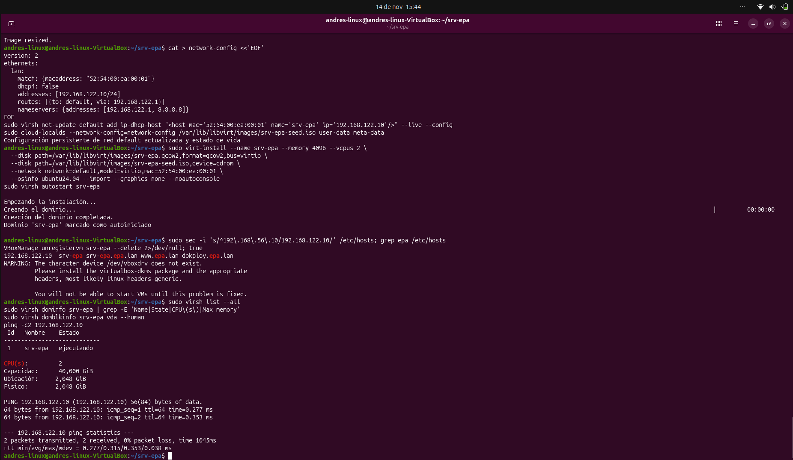

```bash
ssh -i ~/.ssh/id_ed25519_epa epa@192.168.122.10
```
Administración remota con llave SSH (sin contraseña).

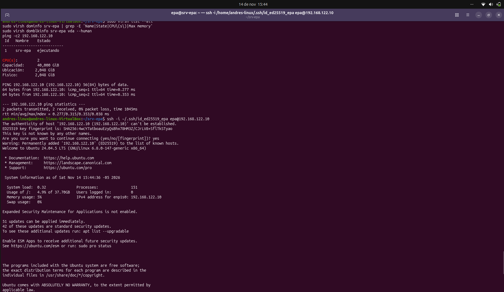

```bash
hostnamectl; nproc; free -h; df -h /
ip -4 -br addr; ip route; ping -c3 ubuntu.com
```
Dentro de la VM: Ubuntu Server 24.04.5 sobre KVM, 2 CPU, 3,8 GB de RAM, 38 GB en `/`, IP estática y salida a internet.

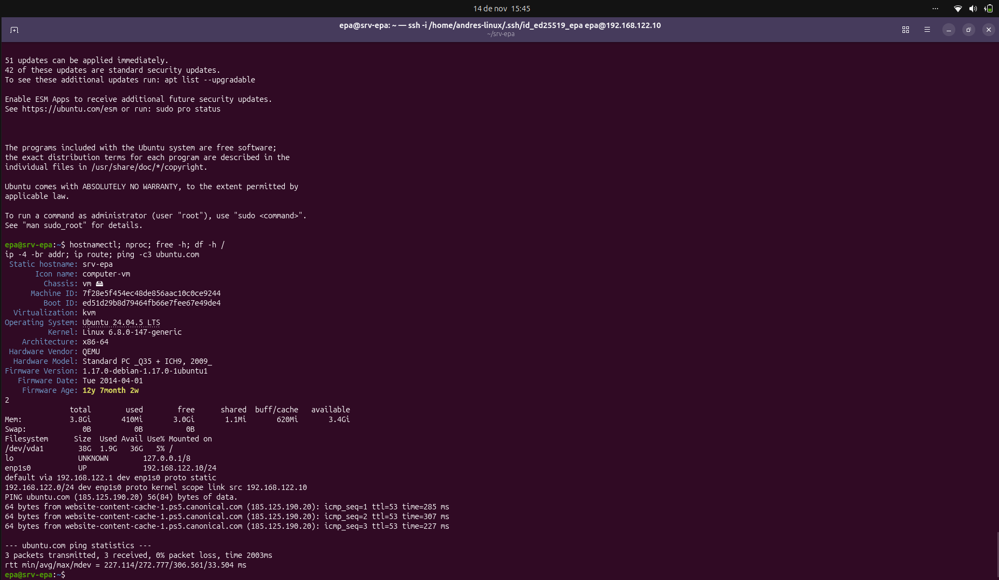

## 4. Dokploy

```bash
curl -sSL https://dokploy.com/install.sh | sudo sh
```
Instala Docker 28.5, inicializa **Docker Swarm** (anuncio en `192.168.122.10`) y despliega Dokploy v0.31.2 con su PostgreSQL interno y el proxy **Traefik**.

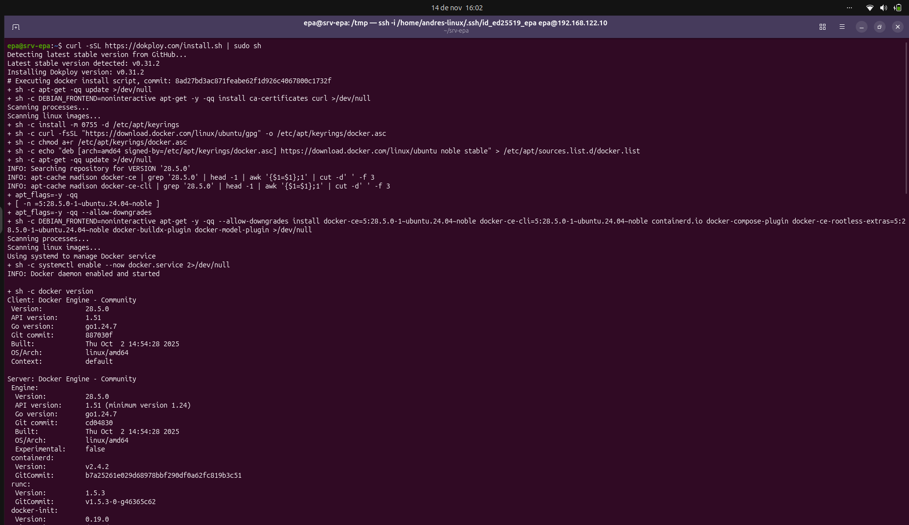
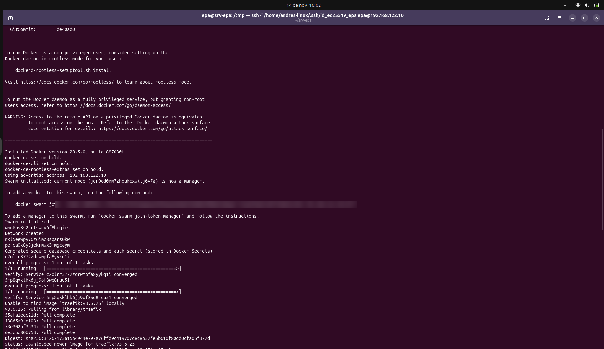

```bash
sudo docker service ls
sudo docker ps --format 'table {{.Names}}\t{{.Image}}\t{{.Status}}'
sudo ss -tlnp | grep -E ':(80|443|3000) '
```
Servicios de Dokploy activos y puertos 80/443 (Traefik) y 3000 (panel) escuchando.

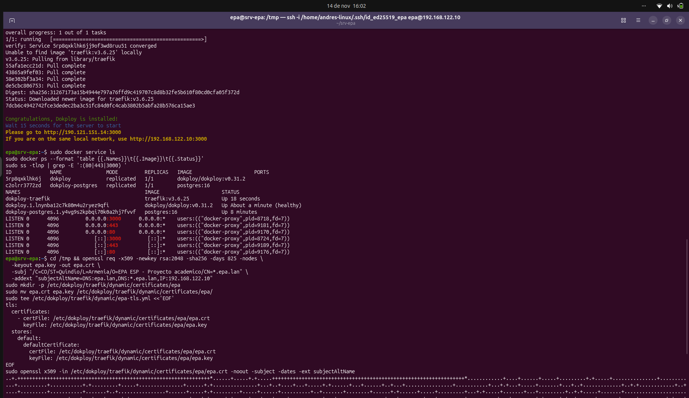

El panel se abre en `http://192.168.122.10:3000`. Ahí se creó el usuario administrador y el proyecto **EPA Armenia**:

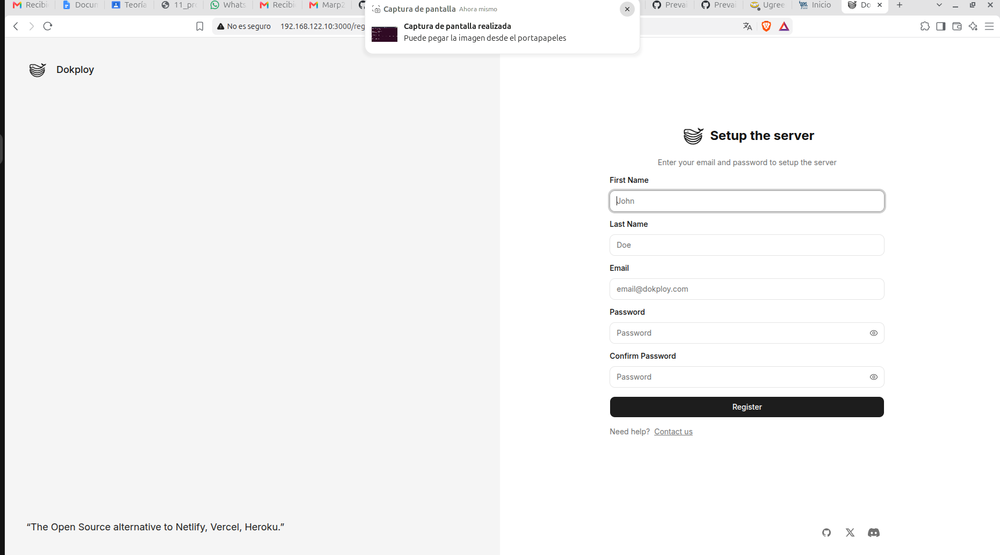
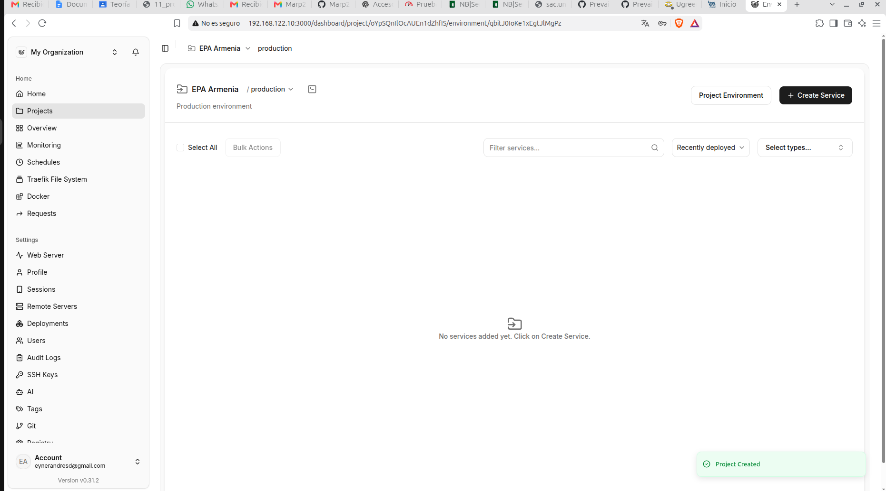

## 5. Dominio y SSL/TLS (certificado autofirmado)

El profesor autorizó trabajar en local, así que se usó el dominio interno **`epa.lan`**:

| Nombre | Apunta a | Uso |
|---|---|---|
| `www.epa.lan` | 192.168.122.10 | Sitio web de la EPA (Traefik → app) |
| `dokploy.epa.lan` | 192.168.122.10 | Panel |
| `srv-epa.epa.lan` | 192.168.122.10 | Servidor |

```bash
# En el anfitrión (cliente): resolución del dominio
echo "192.168.122.10  srv-epa srv-epa.epa.lan www.epa.lan dokploy.epa.lan" | sudo tee -a /etc/hosts
```

Certificado **autofirmado comodín** `*.epa.lan`, cargado en Traefik como certificado por defecto:
```bash
openssl req -x509 -newkey rsa:2048 -sha256 -days 825 -nodes -keyout epa.key -out epa.crt \
  -subj "/C=CO/ST=Quindio/L=Armenia/O=EPA ESP - Proyecto academico/CN=*.epa.lan" \
  -addext "subjectAltName=DNS:epa.lan,DNS:*.epa.lan,IP:192.168.122.10"
sudo mkdir -p /etc/dokploy/traefik/dynamic/certificates/epa
sudo mv epa.crt epa.key /etc/dokploy/traefik/dynamic/certificates/epa/
# + /etc/dokploy/traefik/dynamic/epa-tls.yml  (ver configs/traefik/epa-tls.yml)
```
Traefik vigila la carpeta `dynamic/` y toma el certificado sin reiniciar. Es válido hasta 2029 y cubre `*.epa.lan` y la IP.

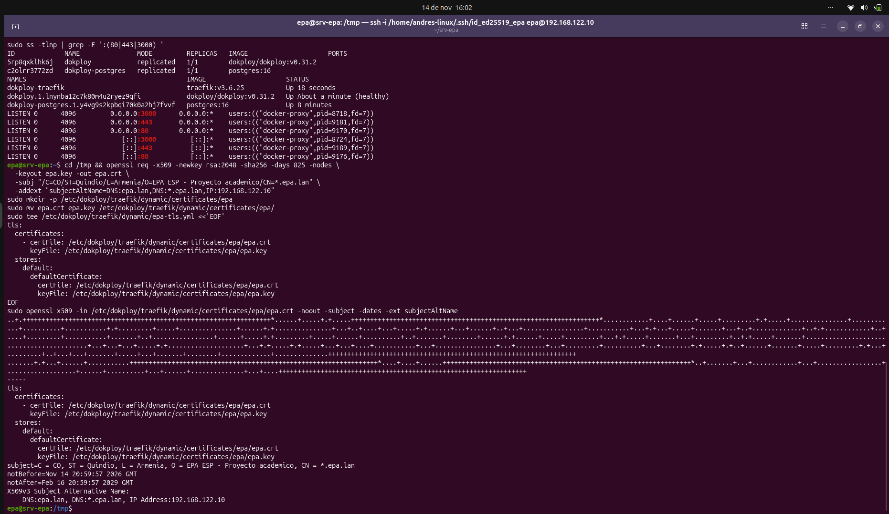

La verificación HTTPS del sitio está en [web-bd.md](web-bd.md).

## 6. Problemas encontrados y solución

| Problema | Causa | Solución |
|---|---|---|
| `modprobe: Module vboxdrv not found` / `Key was rejected by service` | Secure Boot exige módulos firmados; la llave MOK de DKMS no estaba registrada | Se firmó con DKMS y se importó con `mokutil --import`, pero la pantalla de registro (MokManager) nunca apareció al arrancar desde el disco externo |
| La llave seguía `not enrolled` después de cada reinicio (`mokutil --test-key`) | El arranque desde disco externo no mostraba MokManager | Desactivar Secure Boot se descartó porque afecta el Windows del disco interno (BitLocker). **Se cambió a KVM**, que no necesita módulos de terceros |
| `sudo reboot` → *Operation inhibited* | La sesión de GNOME bloquea el reinicio | Reiniciar desde el menú de GNOME o con `systemctl reboot -i` |
| VirtualBox no arranca VMs con kernel ≥ 6.12 | KVM ocupa AMD-V al cargarse | `options kvm enable_virt_at_load=0` en `/etc/modprobe.d/` (ya no aplica al usar KVM) |
| Bridged sobre Wi-Fi no disponible en KVM | Limitación de los puentes con Wi-Fi | Red NAT de libvirt con IP fija y reenvío de puertos para clientes LAN |

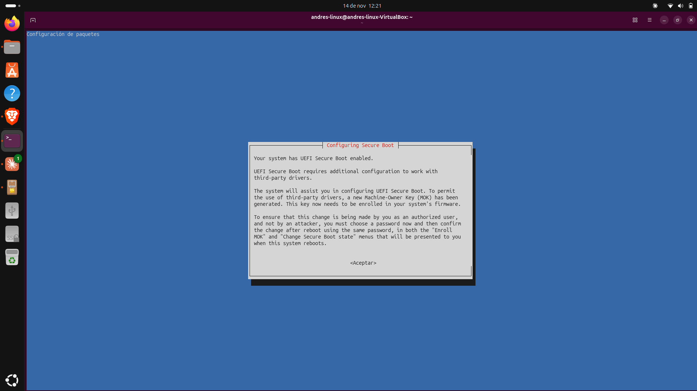
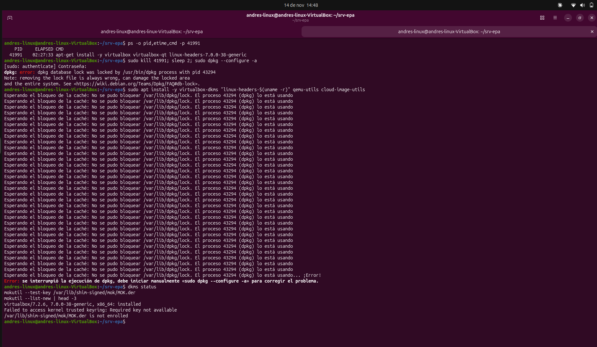
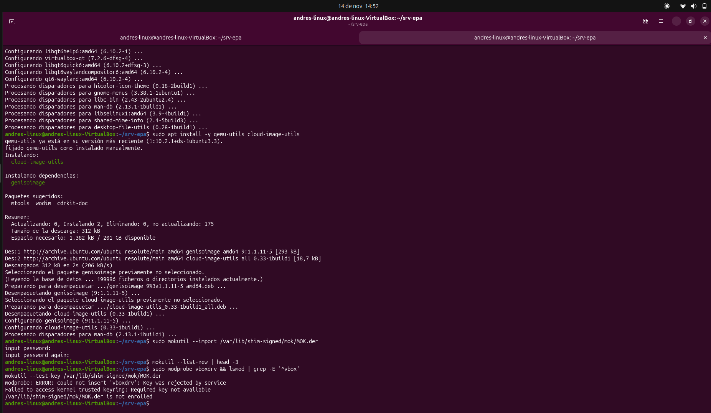
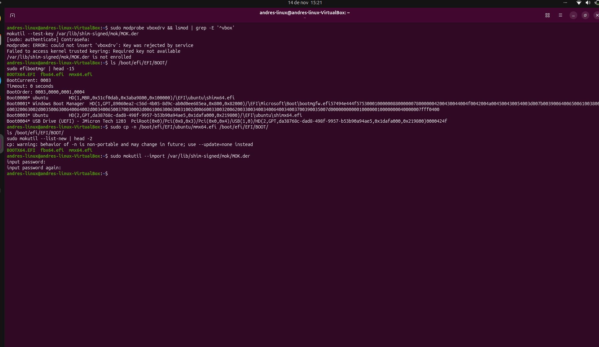
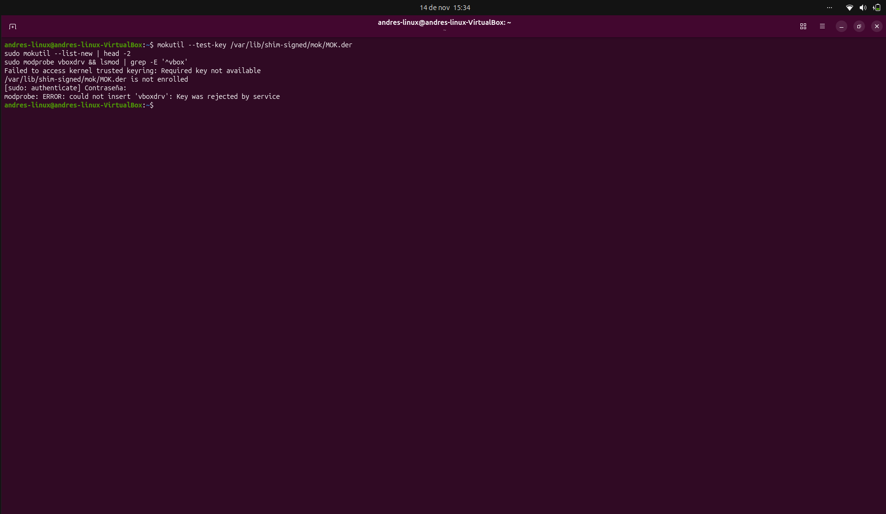
