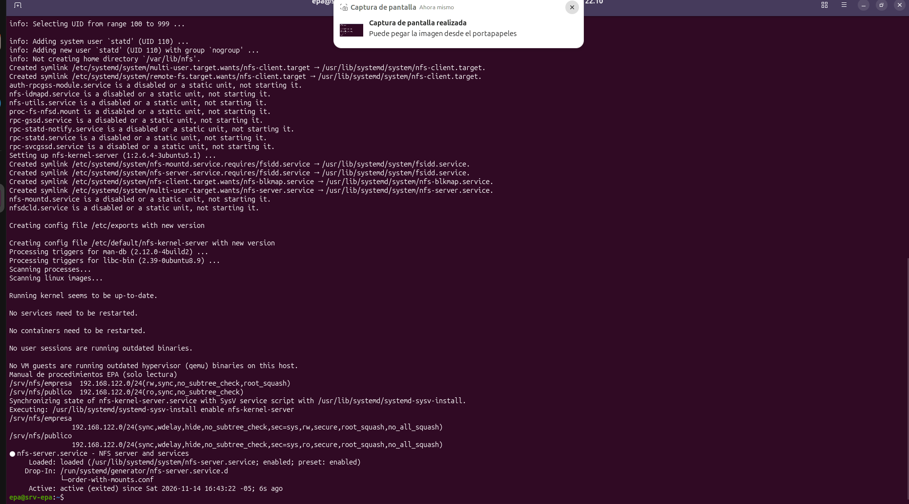
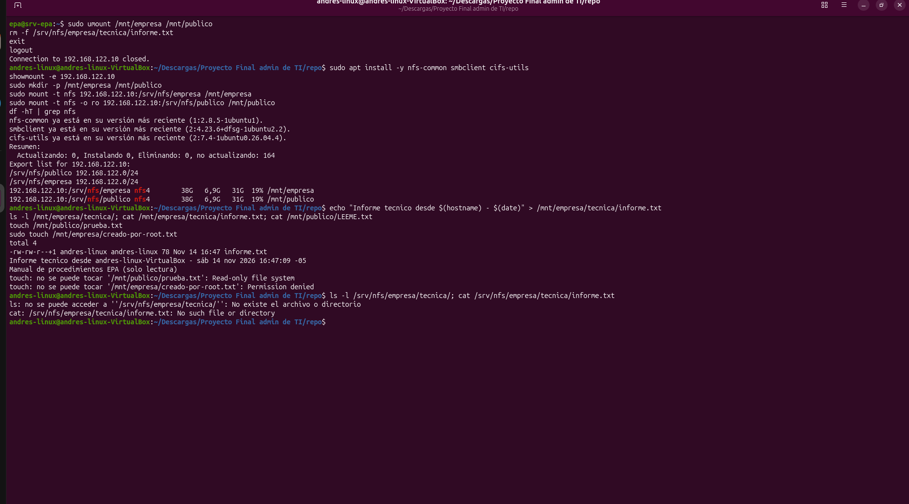
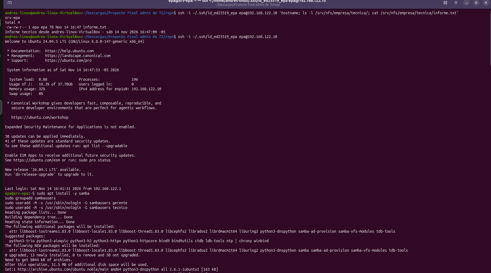

# NFS: archivos compartidos para clientes Linux

**Responsable:** Integrante 2
**Servidor:** `srv-epa` (192.168.122.10) · **Cliente:** anfitrión Ubuntu 26.04 (`andres-linux-VirtualBox`, 192.168.122.1)

| Export | Permiso | Uso |
|---|---|---|
| `/srv/nfs/empresa` (gerencia, tecnica, comercial) | lectura/escritura, `root_squash` | Archivos de trabajo por área |
| `/srv/nfs/publico` | solo lectura | Manuales y documentos de consulta |

## 1. Servidor

```bash
sudo apt install -y nfs-kernel-server
sudo mkdir -p /srv/nfs/empresa/{gerencia,tecnica,comercial} /srv/nfs/publico
sudo chown -R epa:epa /srv/nfs/empresa && sudo chmod -R 2775 /srv/nfs/empresa
sudo tee -a /etc/exports <<'EOF'
/srv/nfs/empresa  192.168.122.0/24(rw,sync,no_subtree_check,root_squash)
/srv/nfs/publico  192.168.122.0/24(ro,sync,no_subtree_check)
EOF
sudo exportfs -ra && sudo systemctl enable --now nfs-kernel-server
sudo exportfs -v; systemctl status nfs-kernel-server --no-pager | head -5
```

| Opción | Para qué |
|---|---|
| `192.168.122.0/24` | Solo la red de la empresa puede montar |
| `rw` / `ro` | Escritura en `empresa`, solo lectura en `publico` |
| `sync` | Confirma la escritura en disco antes de responder (evita pérdida de datos) |
| `root_squash` | El root de un cliente queda como `nobody`: no es root en el servidor |
| `2775` (setgid) | Lo que se crea dentro hereda el grupo de la carpeta |



## 2. Cliente Linux

```bash
sudo apt install -y nfs-common
showmount -e 192.168.122.10
sudo mount -t nfs 192.168.122.10:/srv/nfs/empresa /mnt/empresa
sudo mount -t nfs -o ro 192.168.122.10:/srv/nfs/publico /mnt/publico
df -hT | grep nfs
```
El cliente ve los dos exports y los monta como `nfs4`.

**Prueba de permisos:**
```bash
echo "Informe tecnico desde $(hostname) - $(date)" > /mnt/empresa/tecnica/informe.txt   # OK
touch /mnt/publico/prueba.txt            # Read-only file system
sudo touch /mnt/empresa/creado-por-root.txt   # Permission denied (root_squash)
```


**El archivo escrito por el cliente quedó en el servidor:**
```bash
ssh epa@192.168.122.10 'hostname; ls -l /srv/nfs/empresa/tecnica/; cat /srv/nfs/empresa/tecnica/informe.txt'
```


El UID 1000 del cliente (`andres-linux`) corresponde al UID 1000 del servidor (`epa`), por eso puede escribir. Con NIS ([nis.md](nis.md)) los UID quedan centralizados para todos los clientes.
