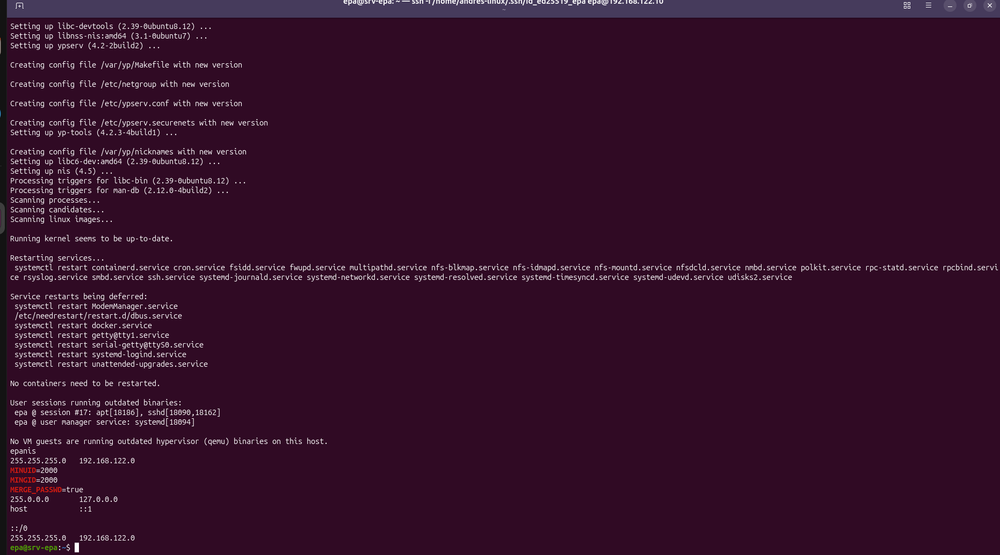
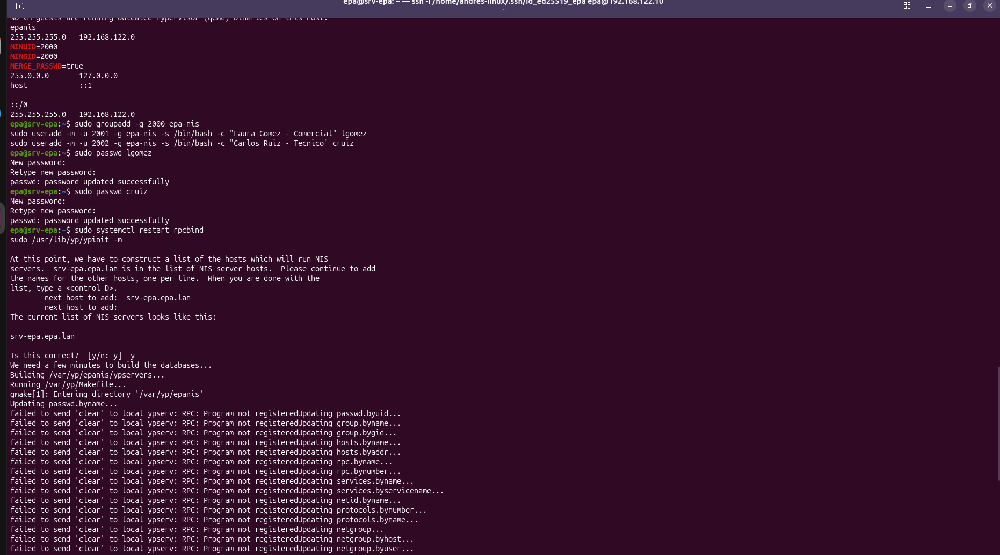
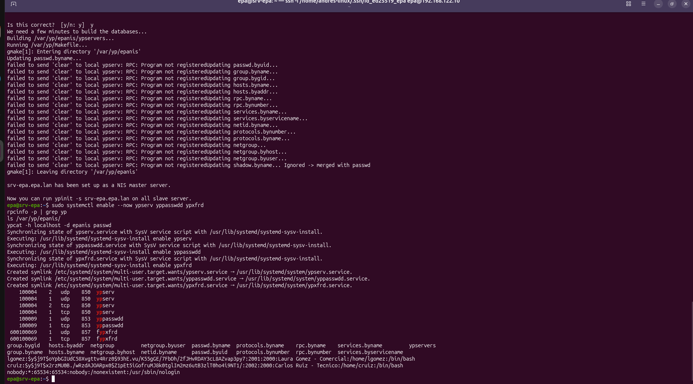
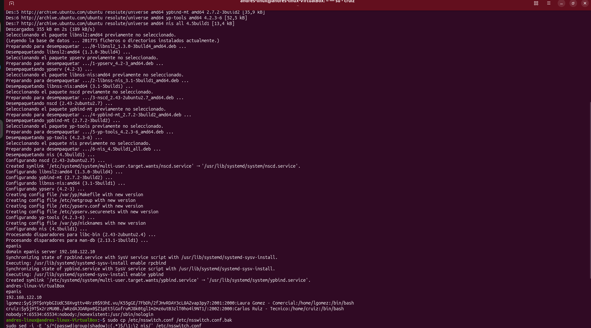
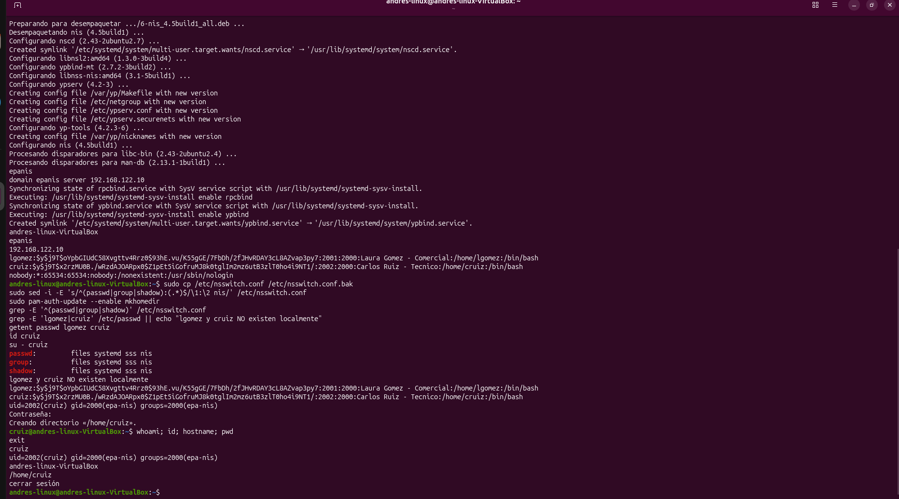

# NIS: autenticación centralizada de usuarios

**Responsable:** Integrante 3
**Dominio NIS:** `epanis` · **Servidor maestro:** `srv-epa` (192.168.122.10) · **Cliente:** anfitrión Ubuntu 26.04

Los usuarios se crean **una sola vez** en el servidor y cualquier equipo cliente puede autenticarlos, sin crearlos localmente.

| Usuario | UID | Grupo | Cargo |
|---|---|---|---|
| `lgomez` | 2001 | epa-nis (2000) | Comercial |
| `cruiz` | 2002 | epa-nis (2000) | Técnico |

## 1. Servidor

```bash
echo "nis nis/domain string epanis" | sudo debconf-set-selections
sudo DEBIAN_FRONTEND=noninteractive apt install -y nis
echo epanis | sudo tee /etc/defaultdomain && sudo domainname epanis
sudo sed -i 's/^NISSERVER=.*/NISSERVER=master/' /etc/default/nis
sudo sed -i 's/^0.0.0.0/#0.0.0.0/' /etc/ypserv.securenets
echo "255.255.255.0   192.168.122.0" | sudo tee -a /etc/ypserv.securenets
sudo sed -i -e 's/^MINUID=.*/MINUID=2000/' -e 's/^MINGID=.*/MINGID=2000/' \
            -e 's/^MERGE_PASSWD=.*/MERGE_PASSWD=true/' /var/yp/Makefile
```

| Cambio | Para qué |
|---|---|
| `NISSERVER=master` | El servidor es el maestro del dominio |
| `ypserv.securenets` | Solo responde a la red 192.168.122.0/24 (antes respondía a todos) |
| `MINUID/MINGID=2000` | Solo publica usuarios de la empresa, no los del sistema ni el admin |
| `MERGE_PASSWD=true` | Incluye el hash en el mapa `passwd` para que el cliente valide la contraseña |



```bash
sudo groupadd -g 2000 epa-nis
sudo useradd -m -u 2001 -g epa-nis -s /bin/bash -c "Laura Gomez - Comercial" lgomez
sudo useradd -m -u 2002 -g epa-nis -s /bin/bash -c "Carlos Ruiz - Tecnico" cruiz
sudo passwd lgomez; sudo passwd cruiz
sudo /usr/lib/yp/ypinit -m          # construye los mapas (Ctrl+D, luego Enter)
```


```bash
sudo systemctl enable --now ypserv yppasswdd ypxfrd
rpcinfo -p | grep yp
ls /var/yp/epanis/
ypcat -h localhost -d epanis passwd
```
`ypserv` y `yppasswdd` quedan registrados en rpcbind. Los mapas (`passwd.byname`, `group.byname`…) quedan construidos y publican a `lgomez` y `cruiz`.



Si se agregan usuarios después: `cd /var/yp && sudo make`.

## 2. Cliente

```bash
echo "nis nis/domain string epanis" | sudo debconf-set-selections
sudo DEBIAN_FRONTEND=noninteractive apt install -y nis libnss-nis rpcbind
echo epanis | sudo tee /etc/defaultdomain && sudo domainname epanis
echo "domain epanis server 192.168.122.10" | sudo tee /etc/yp.conf
sudo systemctl enable --now rpcbind ypbind && sudo systemctl restart ypbind
ypdomainname; ypwhich; ypcat passwd
```
El cliente se une al dominio `epanis`, `ypwhich` confirma el servidor y `ypcat` lee los usuarios.

```bash
sudo cp /etc/nsswitch.conf /etc/nsswitch.conf.bak
sudo sed -i -E 's/^(passwd|group|shadow):(.*)$/\1:\2 nis/' /etc/nsswitch.conf
sudo pam-auth-update --enable mkhomedir
```
`nsswitch.conf` agrega `nis` como fuente de usuarios y grupos. `mkhomedir` crea la carpeta personal en el primer inicio de sesión.



## 3. Prueba de autenticación

```bash
grep -E 'lgomez|cruiz' /etc/passwd || echo "lgomez y cruiz NO existen localmente"
getent passwd lgomez cruiz
id cruiz
su - cruiz          # contraseña definida en el servidor
whoami; id; hostname; pwd
```
Los usuarios **no existen** en el `/etc/passwd` del cliente, pero el sistema los resuelve por NIS. `cruiz` inicia sesión en `andres-linux-VirtualBox` con la contraseña del servidor y se le crea `/home/cruiz`.



## 4. Notas y problemas

- Los avisos `failed to send 'clear' to local ypserv` durante `ypinit -m` son normales: `ypserv` aún no estaba arrancado.
- Revertir el cliente: `sudo cp /etc/nsswitch.conf.bak /etc/nsswitch.conf && sudo systemctl disable --now ypbind`.
- NIS transmite sin cifrado. En producción se reemplazaría por LDAP/FreeIPA con Kerberos, pero aquí se usa porque es lo que pide el curso.
