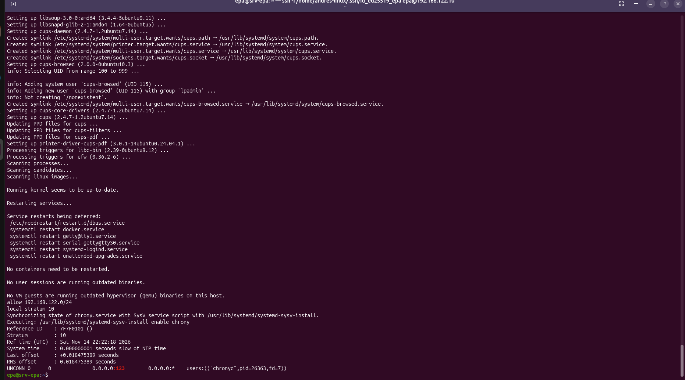
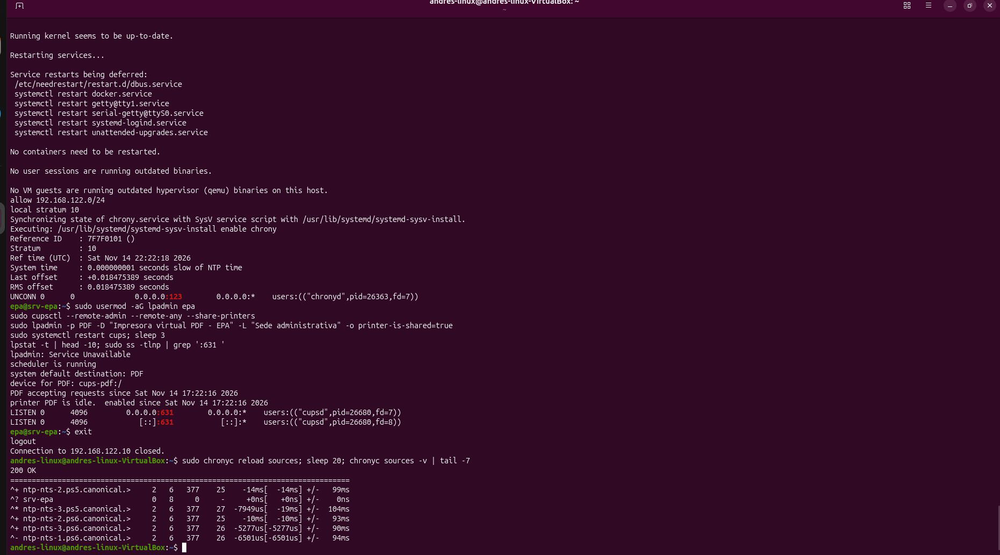
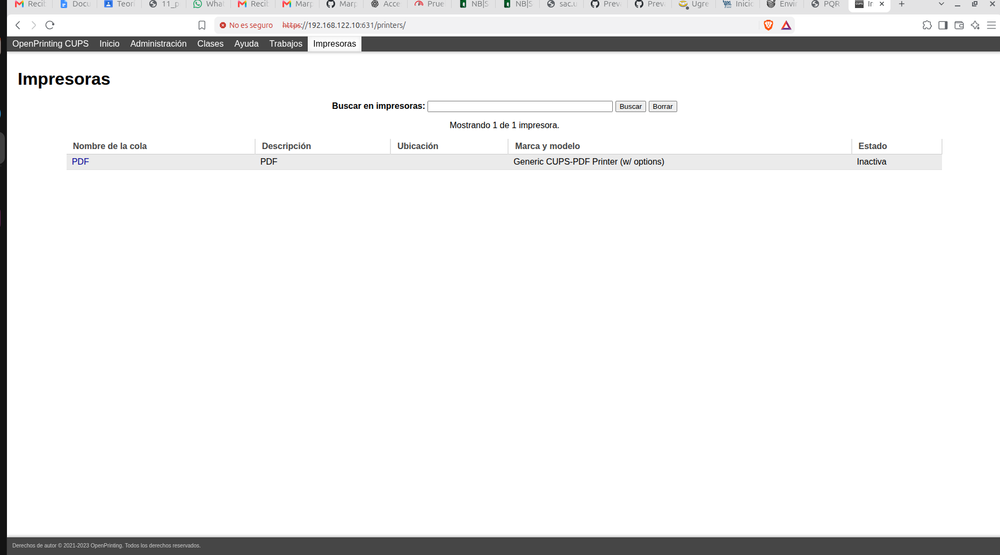
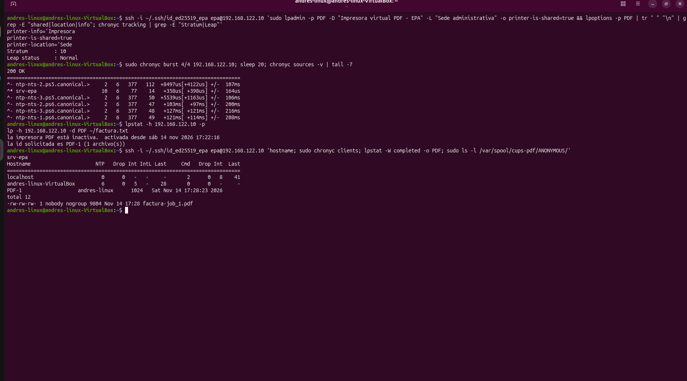

# NTP y CUPS en srv-epa (réplica para la demo integral)

La implementación y evidencia principal de NTP y CUPS es de la **Integrante 4**, en su VM (192.168.40.5) con cliente Windows: ver [ntp.md](ntp.md) y [cups.md](cups.md). Aquí se replicó **la misma configuración** en `srv-epa` (192.168.122.10), para que todos los servicios corran en un solo servidor durante la presentación. El cliente es el anfitrión Linux.

## 1. NTP (chrony)

**Servidor:**
```bash
sudo apt install -y chrony
sudo timedatectl set-timezone America/Bogota
printf "allow 192.168.122.0/24\nlocal stratum 10\n" | sudo tee /etc/chrony/conf.d/epa-servidor.conf
sudo systemctl restart chrony && sudo systemctl enable chrony
chronyc tracking | head -6; sudo ss -ulnp | grep ':123 '
```
`allow` deja que la red de la empresa consulte la hora. `local stratum 10` hace que el servidor siga dando hora aunque no haya internet. Al final, chrony queda escuchando en UDP 123.



**Cliente (anfitrión):**
```bash
echo "server 192.168.122.10 iburst prefer" | sudo tee /etc/chrony/sources.d/srv-epa.sources
sudo chronyc reload sources
sudo chronyc burst 4/4 192.168.122.10; chronyc sources -v
```
El cliente agrega `srv-epa` como fuente preferida. `burst` fuerza consultas inmediatas.

## 2. CUPS

**Servidor:**
```bash
sudo apt install -y cups printer-driver-cups-pdf      # crea la cola "PDF" (impresora virtual)
sudo usermod -aG lpadmin epa
sudo cupsctl --remote-admin --remote-any --share-printers
sudo lpadmin -p PDF -D "Impresora virtual PDF - EPA" -L "Sede administrativa" -o printer-is-shared=true
lpstat -t; sudo ss -tlnp | grep ':631 '
```
`cupsctl` permite la administración remota y comparte impresoras en la red. `lpadmin` marca la cola `PDF` como compartida. CUPS queda escuchando en TCP 631.




**Cliente (anfitrión):**
```bash
lpstat -h 192.168.122.10 -p
lp -h 192.168.122.10 -d PDF ~/factura.txt
```

## 3. Verificación

```bash
ssh epa@192.168.122.10 'hostname; sudo chronyc clients; lpstat -W completed -o PDF; sudo ls -l /var/spool/cups-pdf/ANONYMOUS/'
```
- El anfitrión eligió **`^* srv-epa`** como fuente de hora, y el servidor lista a `andres-linux-VirtualBox` en `chronyc clients`.
- El trabajo **`PDF-1`** del usuario `andres-linux` quedó completado y generó `factura-job_1.pdf` en el servidor.



## 4. Problemas encontrados

| Problema | Causa | Solución |
|---|---|---|
| `lpadmin: Service Unavailable` | CUPS se estaba reiniciando por `cupsctl` | Repetir `lpadmin` unos segundos después |
| `lp: La impresora o clase no está compartida` | La cola no había quedado con `printer-is-shared=true` | El `lpadmin` del punto anterior |
| `srv-epa` aparecía `^?` (reach 0) en el cliente | El cliente consultó antes de que chrony estuviera configurado en el servidor y espació los intentos | `chronyc burst 4/4 192.168.122.10` |
| `srv-epa` reporta `Stratum 10` | En el momento de la prueba servía su reloj local (`local stratum 10`) mientras sincronizaba con internet | Revisar con `chronyc sources` en el servidor. La evidencia de la Integrante 4 muestra el servidor en stratum 3 sincronizado con el pool de Ubuntu |
