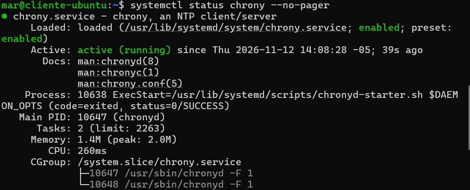
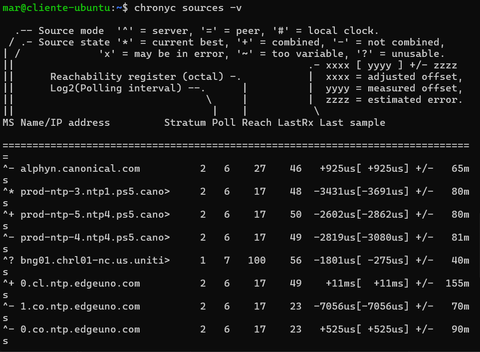
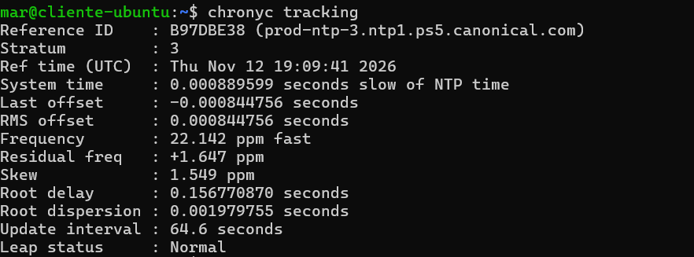
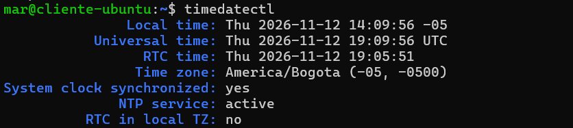
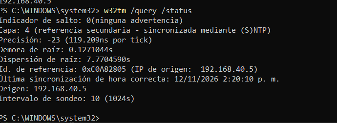
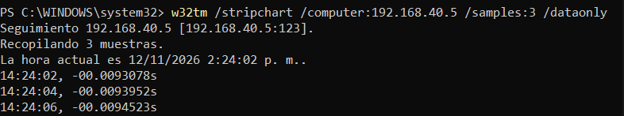

# Servicio NTP (chrony)

**Responsable:** Integrante 4
**Servidor:** Ubuntu Server 24.04.5 LTS en VirtualBox (red en modo Bridged)
**IP del servidor:** 192.168.40.5/24 (estática) | **Gateway:** 192.168.40.1
**Cliente de pruebas:** Windows 11 (equipo anfitrión)

## 1. Objetivo

Configurar un servidor de tiempo para la red local, de modo que los clientes sincronicen su hora contra el servidor. El servidor a su vez se sincroniza con servidores NTP públicos (pool de Ubuntu).

## 2. Decisión de diseño: chrony en lugar de ntp

La guía del proyecto propone el paquete `ntp`, pero ese paquete **ya no existe en Ubuntu 24.04**. Se usó **chrony**, que es el reemplazo recomendado: sincroniza más rápido, funciona bien en máquinas virtuales y cumple el mismo criterio (servidor de tiempo para la red con clientes sincronizados).

## 3. Prerrequisito: IP estática

El proyecto exige IP fija. Se configuró con netplan en `/etc/netplan/01-static.yaml`:

```yaml
network:
  version: 2
  ethernets:
    enp0s3:
      dhcp4: false
      addresses: [192.168.40.5/24]
      routes:
        - to: default
          via: 192.168.40.1
      nameservers:
        addresses: [8.8.8.8, 1.1.1.1]
```

```bash
sudo chmod 600 /etc/netplan/01-static.yaml
sudo netplan apply
ip a | grep 192.168
```

## 4. Instalación en el servidor

```bash
sudo apt update
sudo apt install chrony -y
sudo timedatectl set-timezone America/Bogota
```

## 5. Configuración

Se respaldó el archivo original y se agregaron dos directivas al final de `/etc/chrony/chrony.conf`:

```bash
sudo cp /etc/chrony/chrony.conf /etc/chrony/chrony.conf.bak
echo "allow 192.168.40.0/24" | sudo tee -a /etc/chrony/chrony.conf
echo "local stratum 10" | sudo tee -a /etc/chrony/chrony.conf
sudo systemctl enable --now chrony
sudo systemctl restart chrony
```

| Directiva | Función |
|---|---|
| `allow 192.168.40.0/24` | Permite que los equipos de la red local consulten la hora al servidor |
| `local stratum 10` | Permite seguir sirviendo hora a la red aunque se pierda la conexión a internet |

El firewall `ufw` está inactivo en el servidor (`sudo ufw status` → `inactive`), por lo que no fue necesario abrir el puerto UDP 123.

El archivo final está en [`configs/ntp/chrony.conf`](../configs/ntp/chrony.conf).

## 6. Verificación en el servidor

### 6.1 Servicio activo

```bash
systemctl status chrony --no-pager
```



### 6.2 Fuentes de tiempo

```bash
chronyc sources -v
```

Aparecen fuentes con `^*` (mejor fuente actual) y `^+` (combinadas), lo que confirma que el servidor sincroniza con internet.



### 6.3 Estado de sincronización

```bash
chronyc tracking
```

El servidor opera en **Stratum 3**, con un desfase menor a 1 ms y `Leap status: Normal`.



### 6.4 Reloj del sistema

```bash
timedatectl
```

`System clock synchronized: yes`, `NTP service: active`, zona `America/Bogota`.



### 6.5 Puerto UDP 123 en escucha

```bash
sudo ss -ulnp | grep 123
```

`chronyd` escucha en `0.0.0.0:123`, listo para atender clientes de la red.


## 7. Cliente Windows

Desde PowerShell como administrador:

```powershell
sc.exe config w32time start= auto
net start w32time
w32tm /config /manualpeerlist:"192.168.40.5" /syncfromflags:manual /reliable:no /update
w32tm /resync /force
```

### 7.1 Origen de la hora

```powershell
w32tm /query /source
w32tm /query /status
```

El origen es `192.168.40.5`, en capa 4 (un nivel por debajo del servidor, que es capa 3), con indicador de salto 0.




### 7.2 Comunicación con el servidor

```powershell
w32tm /stripchart /computer:192.168.40.5 /samples:3 /dataonly
```



### 7.3 Prueba de corrección de hora

1. Se desactivó "Establecer la hora automáticamente" y se cambió la hora manualmente.

   

2. Se forzó la sincronización:

   ```powershell
   w32tm /resync /force
   ```

   

3. La hora volvió a ser la correcta:

   

### 7.4 El servidor registra al cliente

En el servidor:

```bash
sudo chronyc clients
```

Aparece la IP del equipo Windows con paquetes recibidos, lo que demuestra que el cliente consulta al servidor.


## 8. Resultado

| Criterio | Estado |
|---|---|
| Servicio NTP activo | Cumplido |
| Servidor sincronizado con fuentes públicas | Cumplido (Stratum 3) |
| Cliente sincroniza con el servidor | Cumplido (Windows, origen 192.168.40.5) |
| IP estática del servidor | Cumplido |

## 9. Problemas encontrados y solución

| Problema | Causa | Solución |
|---|---|---|
| El paquete `ntp` de la guía no se instala | No existe en Ubuntu 24.04 | Usar `chrony` |
| `netplan apply` no aplicaba la IP fija y la IP seguía como `dynamic` | Al pegar el YAML en la consola de VirtualBox se perdió la sangría y hubo un error de escritura (`/724` en vez de `/24`) | Escribir el YAML en una sola línea con `echo ... \| sudo tee`, y mover el archivo roto `50-cloud-init.yaml` fuera de `/etc/netplan/` |
| `Connection refused` al usar SSH hacia el servidor | `openssh-server` no estaba instalado o activo | `sudo apt install openssh-server -y` y `sudo systemctl enable --now ssh` |
| `w32tm /resync`: "el equipo no se sincronizó porque no tenía información de hora disponible" | Windows aún no tenía configurado el servidor como origen | Reconfigurar con `w32tm /config ... /update` y repetir el resync |
| `w32tm /resync /force`: "No se ha iniciado el servicio (0x80070426)" y `net start w32time`: error 1058 | El servicio de hora de Windows estaba **deshabilitado** | `sc.exe config w32time start= auto` y luego `net start w32time`. En PowerShell hay que escribir `sc.exe`, porque `sc` es un alias de otro comando |
| Pérdida de paquetes (33 % a 66 %) al hacer ping a internet desde la VM | Wi-Fi en modo Bridged | No afecta a NTP, que trabaja con la red local; el servidor mantiene la sincronización |
