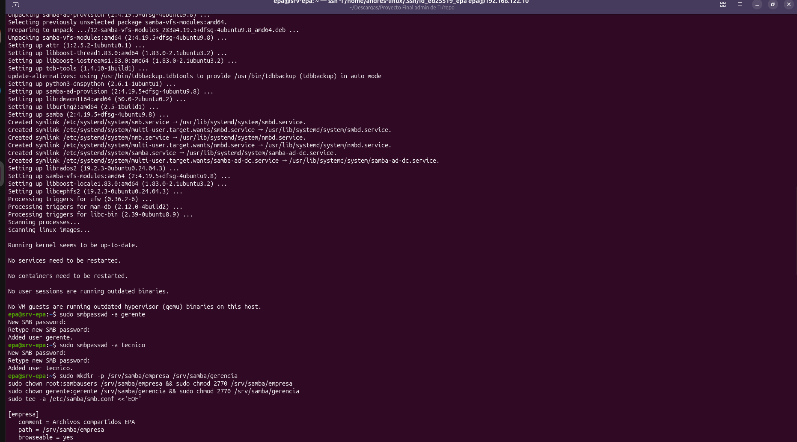
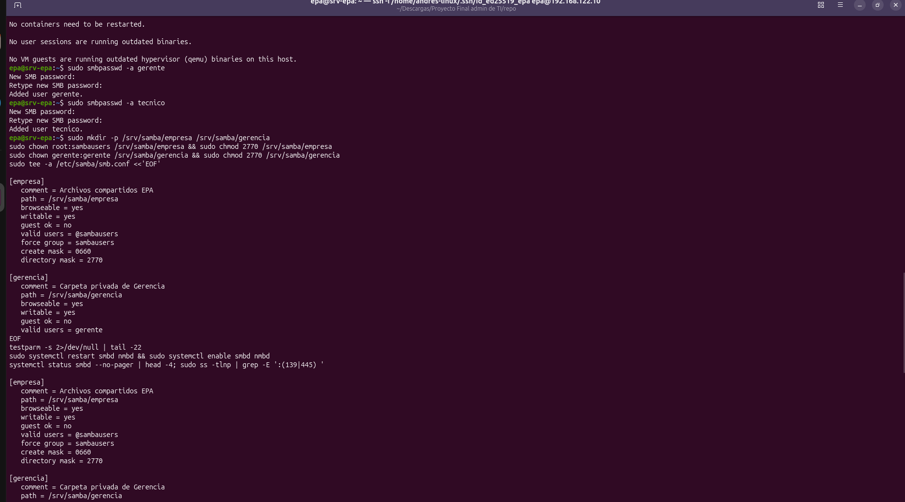
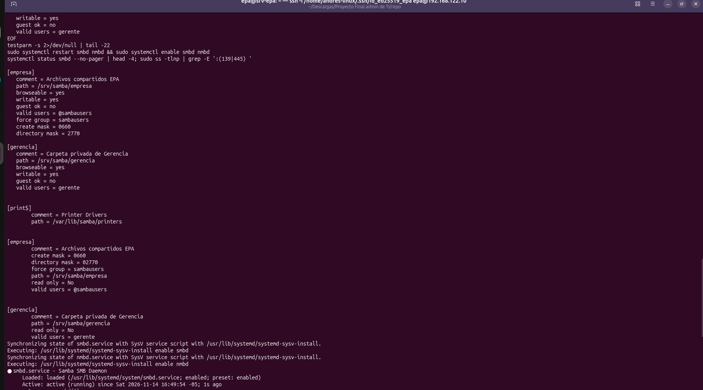
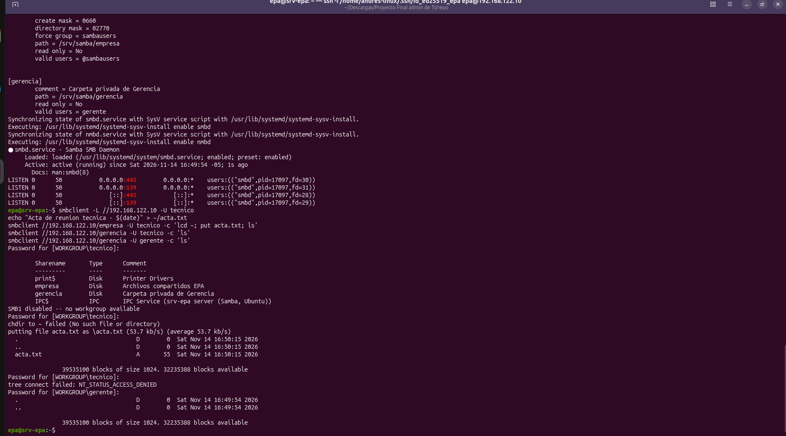
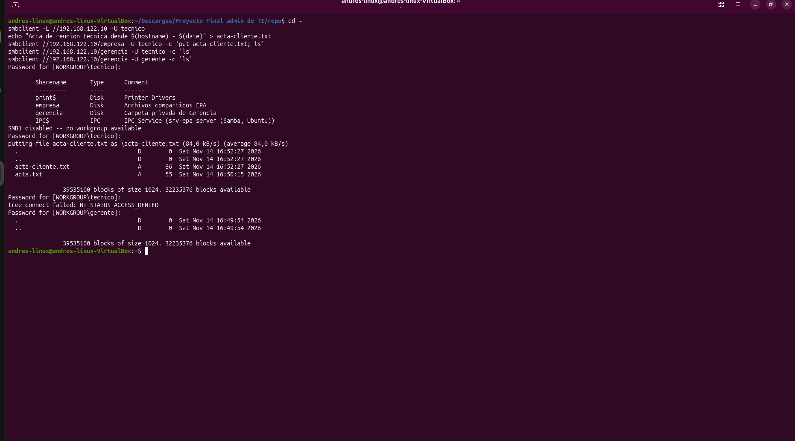
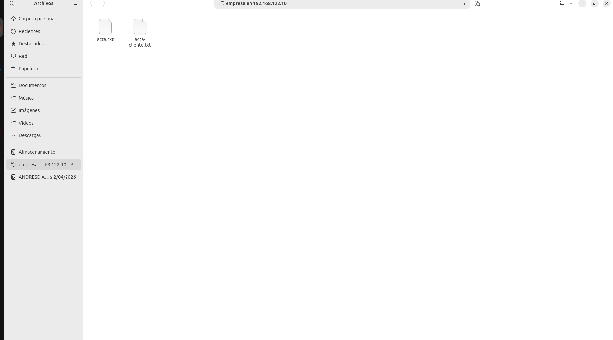

# Samba: carpetas compartidas para Windows/Linux

**Responsable:** Integrante 2
**Servidor:** `srv-epa` (192.168.122.10), Samba 4.19 · **Clientes:** anfitrión Linux (smbclient y explorador de archivos) y PC con Windows

| Recurso | Ruta | Acceso |
|---|---|---|
| `empresa` | `/srv/samba/empresa` | Lectura/escritura para el grupo `sambausers` (gerente, tecnico) |
| `gerencia` | `/srv/samba/gerencia` | Solo el usuario `gerente` |

## 1. Usuarios y carpetas

```bash
sudo apt install -y samba
sudo groupadd sambausers
sudo useradd -M -s /usr/sbin/nologin -G sambausers gerente
sudo useradd -M -s /usr/sbin/nologin -G sambausers tecnico
sudo smbpasswd -a gerente
sudo smbpasswd -a tecnico
sudo mkdir -p /srv/samba/empresa /srv/samba/gerencia
sudo chown root:sambausers /srv/samba/empresa && sudo chmod 2770 /srv/samba/empresa
sudo chown gerente:gerente /srv/samba/gerencia && sudo chmod 2770 /srv/samba/gerencia
```
Los usuarios no tienen shell (`nologin`) ni carpeta personal: solo sirven para Samba. `smbpasswd` les asigna la contraseña de Samba.



## 2. Recursos compartidos (`/etc/samba/smb.conf`)

```ini
[empresa]
   comment = Archivos compartidos EPA
   path = /srv/samba/empresa
   writable = yes
   guest ok = no
   valid users = @sambausers
   force group = sambausers
   create mask = 0660
   directory mask = 2770

[gerencia]
   comment = Carpeta privada de Gerencia
   path = /srv/samba/gerencia
   writable = yes
   guest ok = no
   valid users = gerente
```
`guest ok = no` exige usuario y contraseña. `valid users` limita quién entra a cada recurso. `force group` y las máscaras hacen que lo que se crea quede compartido con el grupo. El archivo completo está en [`configs/samba/smb-epa.conf`](../configs/samba/smb-epa.conf).



```bash
testparm -s
sudo systemctl restart smbd nmbd && sudo systemctl enable smbd nmbd
systemctl status smbd --no-pager | head -4; sudo ss -tlnp | grep -E ':(139|445) '
```
`testparm` valida la sintaxis. Luego `smbd` queda activo y escuchando en 139/445.




## 3. Cliente Linux

```bash
smbclient -L //192.168.122.10 -U tecnico                                   # lista recursos
smbclient //192.168.122.10/empresa  -U tecnico -c 'put acta-cliente.txt; ls'   # escribe OK
smbclient //192.168.122.10/gerencia -U tecnico -c 'ls'                     # NT_STATUS_ACCESS_DENIED
smbclient //192.168.122.10/gerencia -U gerente -c 'ls'                     # OK
```


Explorador de archivos (`smb://192.168.122.10/empresa`, usuario `tecnico`):



## 4. Cliente Windows

La VM está en la red NAT de KVM. Para que un PC de la LAN la alcance, el anfitrión reenvía el puerto 445:
```bash
sudo socat TCP-LISTEN:445,fork,reuseaddr TCP:192.168.122.10:445
```
En Windows: Explorador → `\\192.168.1.39\empresa` → usuario `tecnico`.

El acceso con el protocolo SMB es el mismo que usan `smbclient` y el explorador de archivos de Linux (sección 3), donde quedan demostrados los permisos por usuario. La prueba en vivo desde Windows se hace en la presentación.
